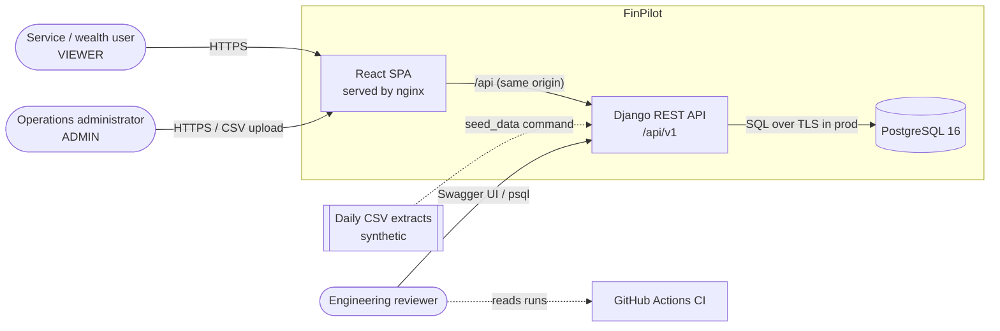
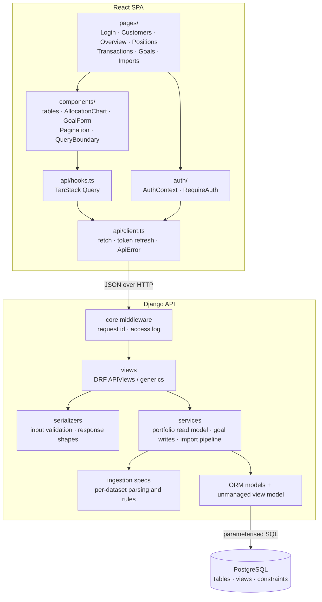
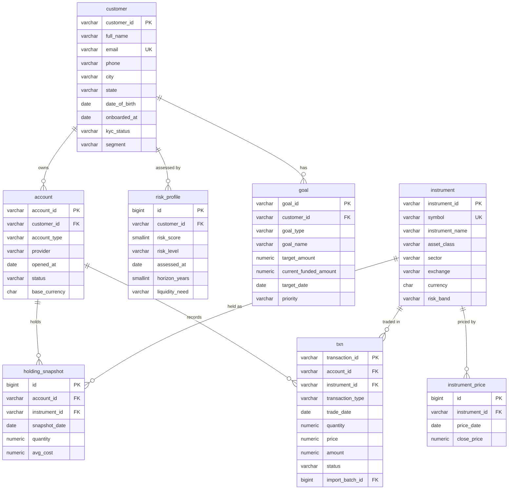
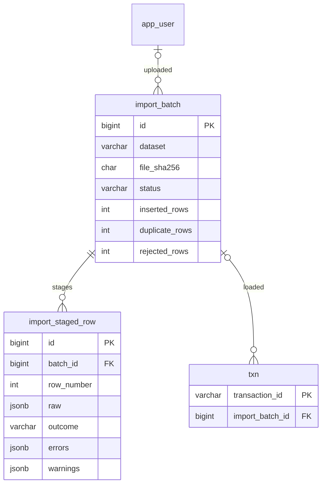
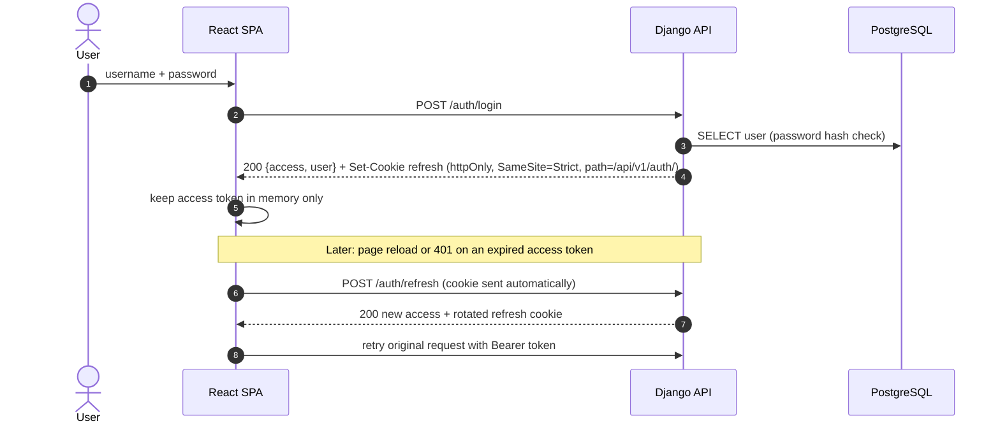
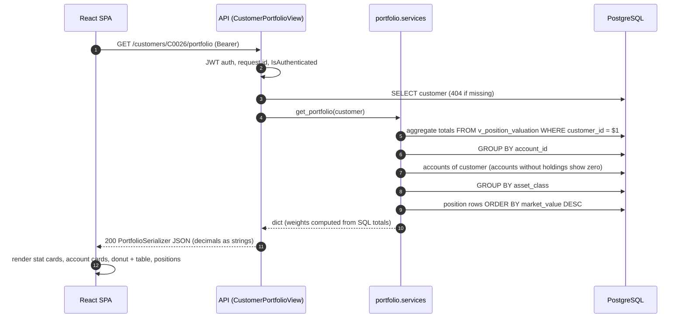
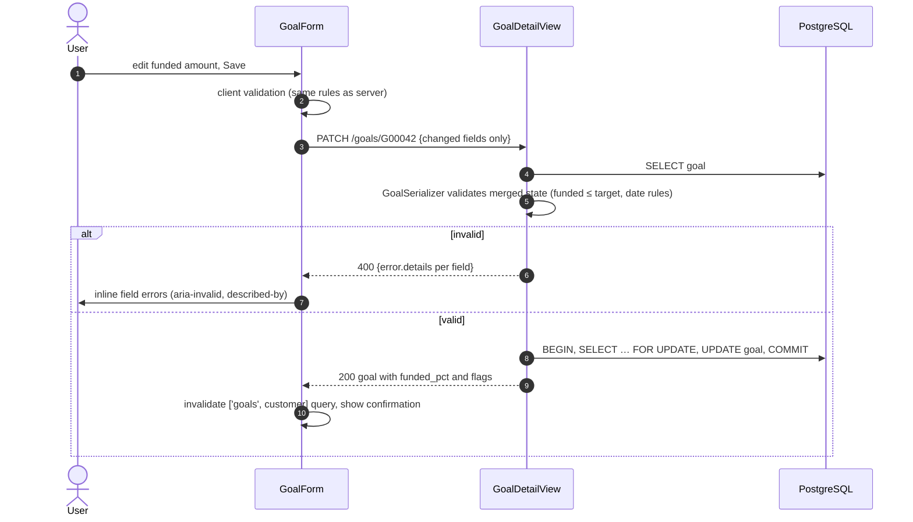
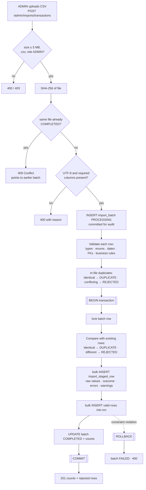
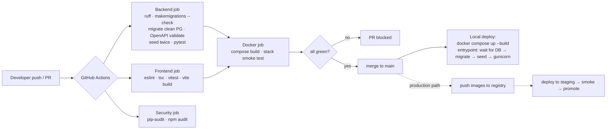
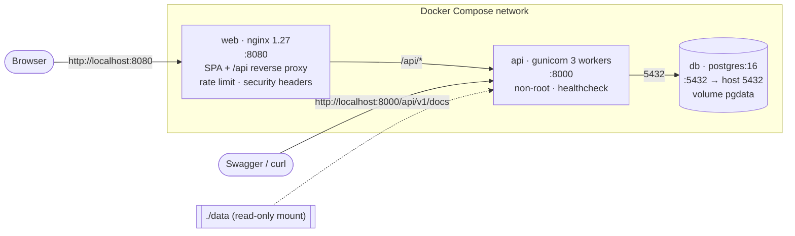

# FinPilot: Architecture and Design Report

Investment Portfolio & Goal Monitoring Platform. Synthetic assessment data only.

## 1. Executive overview

**Problem.** An internal wealth-service team needs one place to find a customer and understand
their consolidated investment position: portfolio value, allocation, positions, recent activity,
risk profile and financial goals. Operations administrators need to load daily CSV extracts
safely, see why rows were rejected, and never double-load data.

**Scope delivered.** Sign-in with VIEWER and ADMIN roles; customer search; customer profile with
the latest risk profile; portfolio dashboard (customer and account totals, allocation chart,
positions with unrealised gain/loss, data freshness); server-side filtered and paginated
transactions; goal list, create and edit with validation and overdue/inconsistency flags; an
admin CSV import workflow with staging, row-level reasons and an explicit duplicate policy;
OpenAPI documentation; health checks; JSON logs with request correlation; Docker Compose; CI.

**Stack.** React 19 + TypeScript (Vite, TanStack Query, Recharts) · Django 5.2 LTS + Django REST
Framework · PostgreSQL 16 · nginx · Docker Compose · GitHub Actions.

**Major design decisions.**

| Decision | Rationale |
|---|---|
| Aggregation in PostgreSQL views (`v_position_valuation`) | One definition of "market value" used by the API and by ad-hoc SQL; no aggregation in the browser; constant query count per request. |
| Constraints in the database, not only in code | CHECK/UNIQUE/FK constraints make invalid states impossible from any path (API, import, psql). |
| Stage every imported row, then merge in one transaction | Rejections are queryable data (quarantine), imports are all-or-nothing, and the audit trail survives failures. |
| Identical re-sent rows are skipped; conflicting ones are rejected | Idempotent loads without silent overwrites. |
| Access token in memory, refresh token in httpOnly SameSite=Strict cookie | Limits XSS token theft and CSRF while keeping a stateless API. |
| Same-origin deployment (nginx/Vite proxy `/api`) | No CORS in the browser path, strict cookie settings work, one TLS endpoint in production. |

## 2. System context



| Actor / system | Interaction |
|---|---|
| Service user (VIEWER) | Searches customers, reviews portfolio, transactions and goals; creates and edits goals. |
| Operations administrator (ADMIN) | Everything a viewer can do, plus CSV imports and import history. |
| Engineering reviewer | Swagger UI, health endpoint, logs, SQL in `docs/sql/`, CI runs. |
| External dependencies | None at runtime. Build-time: PyPI, npm registry, Docker Hub images. Swagger UI assets load from the jsDelivr CDN. |

## 3. Component architecture



| Layer | Responsibility |
|---|---|
| `apps/core` | Request-id middleware, JSON log formatter, uniform error envelope, pagination, liveness/readiness. |
| `apps/users` | Custom `User` with `role`; login/refresh/logout/me; `IsAdminRole` permission. |
| `apps/portfolio` | Domain models and constraints, reporting views, `get_portfolio()` read model, goal create/update services, API views. |
| `apps/ingestion` | Strict field parsers, `DatasetSpec` per CSV, `run_import()` pipeline, `seed_data` command, import API. |
| Data-access boundary | Views never build SQL; they call services or querysets. All SQL is parameterised by the ORM; the only raw SQL is static (migrations, sequence calls). |
| Frontend state | Server state in TanStack Query (cache keyed by filters); filter state in the URL (shareable, back-button safe); auth state in a React context. |

## 4. ERD / data model

**Core domain.**



**Import audit and staging.**



**Cardinalities.** A customer has 1..n accounts (every supplied customer has at least one), 0..n
risk profiles (the latest by `assessed_at` is "current"), and 0..n goals. An account has 0..n
holdings per snapshot date and 0..n transactions.

**Key constraints beyond PK/FK/NOT NULL.**

- `txn_shape_matches_type`: BUY/SELL need quantity > 0 and price > 0; DIVIDEND/FEE need both = 0.
- `holding_unique_position (account, snapshot_date, instrument)`: duplicate positions cannot
  double-count value.
- `customer_dob_before_onboard`, `risk_score_range`, every enum as a CHECK, ISO currency regex.
- `import_batch_file_once`: partial unique index on `(dataset, file_sha256) WHERE status='COMPLETED'`.

**Indexes (by query pattern).**

| Index | Serves |
|---|---|
| `txn_account_date_idx (account_id, trade_date DESC, transaction_id DESC)` | Transaction listing: `account_id IN (…)` + date range + newest-first ordering. |
| `txn_instrument_idx`, `txn_trade_date_idx` | Instrument filter; monthly flow reporting across all accounts. |
| `holding_unique_position` | Latest-snapshot lookup per account (leading `account_id, snapshot_date`). |
| `holding_instrument_idx` | "Distinct holders per instrument". |
| `customer_name_trgm`, `customer_email_trgm` (GIN, `gin_trgm_ops`) | Case-insensitive substring search. |
| `risk_profile_one_per_day (customer_id, assessed_at)` | Latest risk profile per customer. |
| `goal_customer_idx (customer_id, target_date)` | Goal list in target-date order. |
| `staged_row_exceptions_idx` (partial, `outcome <> 'INSERTED'`) | Quarantine queries without indexing the 99% happy rows. |

Django's automatic single-column FK indexes were dropped where a composite index already leads
with the same column (migration `0003`), after `EXPLAIN (ANALYZE, BUFFERS)` showed the planner
picking the narrower index and filtering dates afterwards. With the composite index the date
predicate becomes an index condition (`docs/sql/explain_transactions_listing.txt`; 0.14 ms,
15 shared-buffer hits).

**Derived views.**

- `v_latest_price`: `DISTINCT ON (instrument_id) … ORDER BY price_date DESC`.
- `v_position_valuation`: each account's latest snapshot joined to the latest price, exposing
  cost basis, market value and unrealised P/L per position. Exposed to Django as an unmanaged
  read-only model.
- `v_monthly_net_flows`: settled BUY/SELL amounts per customer, account and month with
  `SUM(...) FILTER (WHERE ...)`.

## 5. API design

All endpoints are under `/api/v1` (URL versioning: a breaking change ships as `/api/v2` alongside
v1). The OpenAPI 3 document is generated from code (`/api/v1/schema`), validated in CI with
`--fail-on-warn`, and browsable at `/api/v1/docs`.

| Method | Path | Auth | Purpose |
|---|---|---|---|
| POST | `/auth/login` | public, throttled | Username/password → access token + refresh cookie |
| POST | `/auth/refresh` | refresh cookie | Rotate refresh token, new access token |
| POST | `/auth/logout` | public | Clear refresh cookie |
| GET | `/auth/me` | any role | Current user |
| GET | `/customers` | any role | `search`, `city`, `kyc_status`, `segment`, `ordering` (incl. AUM), `page`, `page_size` |
| GET | `/customers/{id}` | any role | Profile, latest risk profile, accounts |
| GET | `/customers/{id}/portfolio` | any role | Totals, per-account totals, allocation, positions, `as_of` dates |
| GET | `/customers/{id}/transactions` | any role | `date_from`, `date_to`, `account`, `instrument`, `type`, `status`, `ordering`, pagination |
| GET / POST | `/customers/{id}/goals` | any role | List with `funded_pct` and `flags`; create |
| GET / PATCH | `/goals/{goalId}` | any role | Read; partial update (PUT not allowed) |
| GET | `/instruments` | any role | Security master for filter pickers |
| POST | `/admin/imports/{dataset}` | ADMIN | Multipart CSV upload → counts + rejected rows |
| GET | `/admin/imports`, `/admin/imports/{id}`, `/admin/imports/{id}/rows` | ADMIN | History, batch detail, staged rows by outcome |
| GET | `/health`, `/health/live` | public | Readiness (DB + migrations) / liveness |

**Validation.** Every write and every query parameter passes through a DRF serializer. Invalid
filters return 400 rather than being ignored (for example `date_from > date_to`, an unknown
`type`). Goal PATCH validates the merged state, so a partial update cannot make a goal
inconsistent.

**Pagination.** Page-number pagination (`count`, `next`, `previous`, `results`), default 25,
maximum 200. Offset pagination is fine at this size; keyset pagination on
`(trade_date, transaction_id)` is the next step for very large ledgers and is already supported
by the index.

**Error model.** One envelope for every error, with the request id for support:

```json
{"error": {"code": "validation_error", "message": "The request contains invalid fields.",
           "details": {"date_to": ["must be on or after date_from"]},
           "request_id": "7c8327139a854cc48800dcfc8e0b50e8"}}
```

Status codes: 400 validation, 401 unauthenticated/expired, 403 wrong role, 404 unknown id,
405 PUT on goals, 409 file already imported, 429 throttled, 500 generic message (stack trace
logged server-side only), 503 not ready.

## 6. Workflow diagrams

### 6.1 Login and session restore



### 6.2 Customer portfolio read



The request issues a fixed number of queries (tested: at most 6) regardless of how many accounts
or positions the customer has.

### 6.3 Goal update



### 6.4 CSV import



### 6.5 CI/CD and deployment



## 7. Deployment topology



| Item | Local | Production mapping |
|---|---|---|
| Web | nginx container serving the Vite build, proxying `/api` | CDN or nginx/ingress in front of object storage; TLS terminated at the load balancer (managed certificate, HSTS, HTTP→HTTPS redirect) on a single domain |
| API | gunicorn container, migrations + seed in entrypoint | Container service (ECS/Cloud Run/Kubernetes) with 2+ replicas; migrations run as a one-off release job before the rollout, not in every replica |
| Database | `postgres:16` with a named volume, bound to 127.0.0.1 | Managed PostgreSQL (RDS/Cloud SQL), Multi-AZ, private subnet, TLS required, PgBouncer for pooling |
| Secrets | `.env` (git-ignored) from `.env.example` | Secrets manager injected as env vars; separate DB roles for migrations (DDL) and the app (DML only) |
| Environments | one local stack | dev → staging → production with the same images, promoted by digest |
| Ports | 8080 web, 8000 API, 5432 DB (all loopback-only) | Only 443 public; API and DB not internet-facing |

## 8. Security

| Area | Implementation |
|---|---|
| Authentication | JWT access token (15 min) in memory; rotating refresh token (8 h) in an httpOnly, SameSite=Strict cookie scoped to `/api/v1/auth/`; `Secure` flag on by default and only disabled through env for plain-HTTP localhost. |
| Authorisation | Default-deny: `IsAuthenticated` globally; `IsAdminRole` on every import endpoint; role stored server-side and also as a token claim for the UI. New users default to VIEWER. |
| Input validation | DRF serializers for every body and query parameter; strict CSV parsers (formats, enums, precision, ranges, FK existence); upload size and extension limits; DB constraints as the last line of defence. |
| SQL injection | ORM with bound parameters everywhere; ordering via allow-lists; raw SQL only in static migrations. |
| CORS / CSRF | Browser traffic is same-origin through the proxy, so CORS is not needed; `CORS_ALLOWED_ORIGINS` is an explicit allow-list for tooling. Bearer tokens are not sent automatically, and the cookie is SameSite=Strict, so CSRF does not apply to the API. |
| Secrets | None in Git: `.env` is ignored; `.env.example` holds placeholders; the API refuses to start without `DJANGO_SECRET_KEY` when not in debug; demo passwords come from env. |
| Transport and headers | nginx: CSP, `X-Frame-Options DENY`, `nosniff`, `Referrer-Policy`; production adds TLS and HSTS. |
| Abuse | Login throttle (10/min/IP), nginx API rate limit (20 r/s, burst 40). |
| Logs and PII | Logs carry ids (user, customer, goal, batch) and outcomes, not names, emails or phone numbers. Failed logins log the attempted username only. The UI shows data to authenticated staff only. |
| Errors | Stack traces are logged, never returned; clients get a generic message plus a request id. |
| Supply chain | `pip-audit` and `npm audit` in CI; pinned Python versions; npm lockfile. |
| Container | API runs as non-root UID 10001; DB and API ports bound to loopback. |

**Next security steps:** refresh-token revocation list, per-customer access scoping, audit table
for goal changes, MFA through an identity provider (OIDC), field-level encryption or masking of
phone/email for lower-privilege roles, SAST (Semgrep/CodeQL) in CI.

## 9. Reliability and operations

- **Health checks.** `/api/v1/health/live` checks the process only (used by the container
  healthcheck so a DB outage does not restart-loop the API). `/api/v1/health` checks DB
  connectivity and pending migrations and returns 503 when not ready (for load-balancer
  readiness). nginx exposes `/healthz`. Compose orders start-up on these checks.
- **Logging.** One JSON object per line: timestamp, level, logger, message, `request_id`, plus
  structured fields (method, path, status, duration_ms, user_id; batch_id and counts for
  imports). The request id is accepted from `X-Request-ID` (nginx sets one) or generated,
  echoed in the response header, and included in every error body, so a user-reported reference
  leads straight to the log lines.
- **Monitoring (production).** Ship logs to a central store (CloudWatch/Loki); alert on 5xx rate,
  p95 latency, import FAILED batches and rejected-row spikes; DB metrics (connections, slow
  queries via `pg_stat_statements`).
- **Timeouts.** PostgreSQL `statement_timeout` 10 s and `connect_timeout` 5 s on API
  connections; gunicorn worker timeout 30 s; nginx `proxy_read_timeout` 30 s. The SPA retries
  failed reads twice, never 4xx responses, and never writes.
- **Failure behaviour.** Imports are atomic (all valid rows or none); a failed batch is recorded
  as FAILED with a reason. Goal edits lock the row (`SELECT … FOR UPDATE`). Concurrent imports
  of the same dataset serialise on the batch lock. The UI shows explicit loading, empty and error
  states with retry and the request id.
- **Connection pooling.** Persistent connections per gunicorn worker (`CONN_MAX_AGE=60` with
  health checks). Production: PgBouncer in transaction mode, sized as replicas × workers below
  the server's `max_connections`.
- **Backups.** Managed PostgreSQL automated backups with point-in-time recovery (7–35 days),
  plus a nightly logical `pg_dump` to separate storage; restore drills on staging. Locally,
  `docker compose exec db pg_dump`.
- **Migration rollback.** Each migration is transactional; failed migrations roll back. Custom
  SQL migrations ship reverse SQL. Production uses expand-then-contract changes so the previous
  release keeps working, and runs migrations as a separate release step.

## 10. Trade-offs and roadmap

**Intentionally omitted** (details in `DECISIONS.md`): refresh-token revocation, per-customer
authorisation, asynchronous imports, reconciliation of positions against transactions,
multi-currency valuation, edit/delete of master data in the UI, and local TLS.

**Expected scale limits.** The supplied data (120 customers, 4.5k transactions) answers every
request in milliseconds. With the current design the comfortable range is roughly 10⁵ customers
and 10⁷ transactions on one PostgreSQL instance:

- Transaction listing stays index-driven; deep page offsets degrade, so switch to keyset
  pagination for very large ledgers.
- `v_position_valuation` is computed on read; at millions of positions, turn it into a
  materialised view refreshed after each snapshot/price load, or store daily valuations.
- Customer list AUM uses a correlated subquery per page row; precompute AUM per customer per
  snapshot when the customer count grows.
- In-request imports suit files up to a few MB; larger files move to a worker queue
  (Celery/RQ) with `COPY` into staging tables.

**Next production steps.** Identity provider (OIDC) with MFA; object-level access control and
an audit log; Redis for shared throttling and caching; background import worker with progress
reporting; container registry and staged deployments; OpenTelemetry tracing; partition `txn` by
trade month once it reaches tens of millions of rows; Playwright end-to-end tests in CI.
